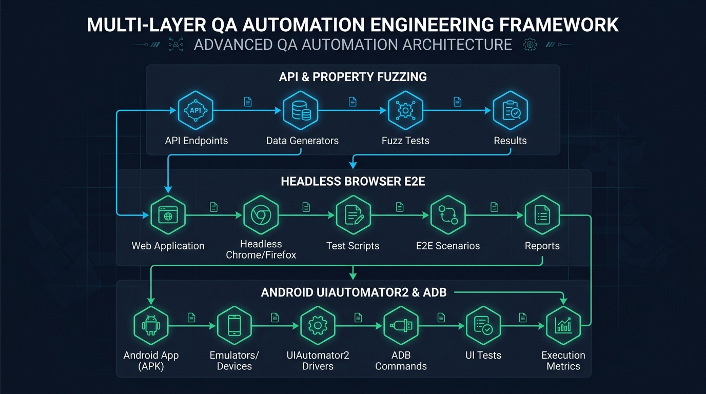
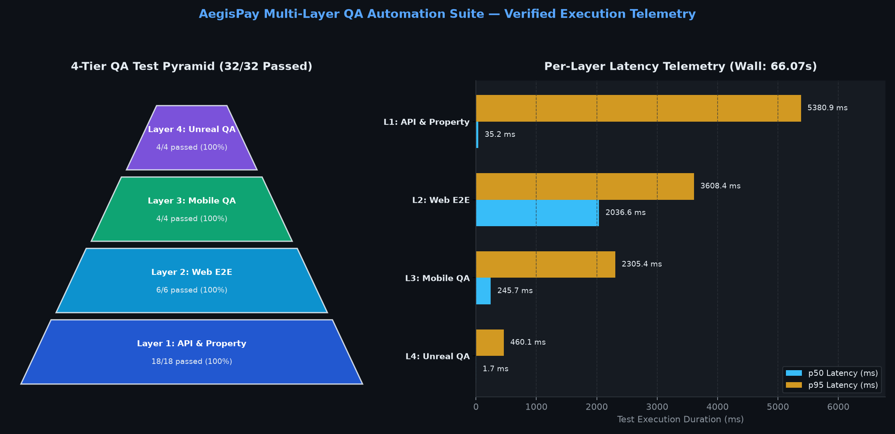
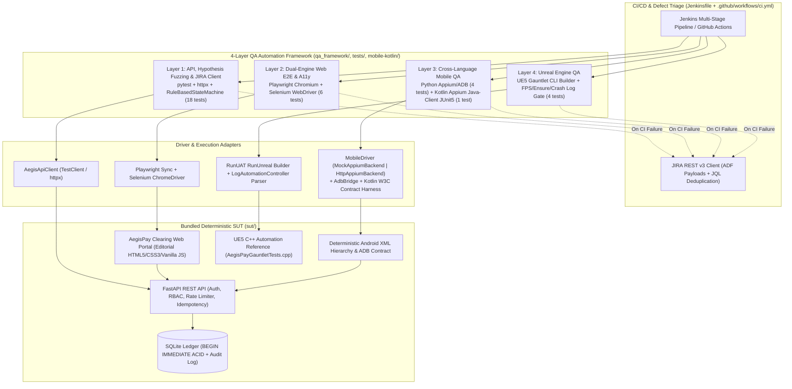
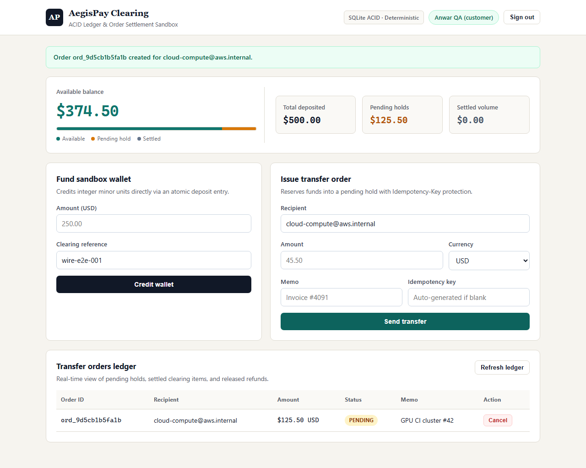
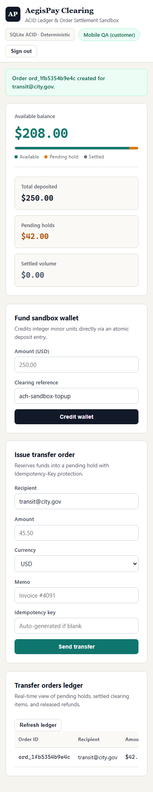
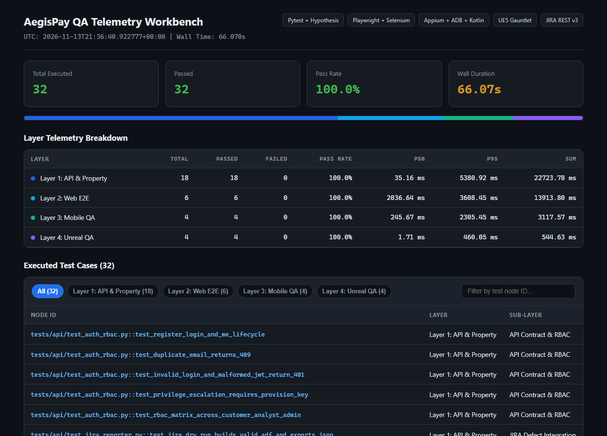

# AegisPay Multi-Layer QA Automation Suite



A **Staff-Engineer / PhD-grade 4-Layer QA Automation Framework** targeting a deterministic FinTech Clearing, Auth, and Order Settlement Sandbox (**AegisPay**). Built for **zero-flakiness CI/CD execution** across **GitHub Actions** and **Jenkins**, the suite unifies **API Contract + Hypothesis Stateful Fuzzing**, **Dual-Engine Headless Web E2E (Playwright + Selenium WebDriver)**, **Cross-Language Mobile QA (Python Appium UIAutomator2/ADB + Kotlin Appium Java-Client/JUnit5)**, **Unreal Engine 5 Gauntlet & Frame-Budget Automation**, and **JIRA REST v3 Defect Triage**.

---

## Live Walkthrough & Visual Proof

| Walkthrough Preview (Upgraded Clearing Portal + Telemetry Workbench) | 4-Tier Test Pyramid & Latency Telemetry |
| :---: | :---: |
|  |  |

- **Full Recorded Video**: [`docs/images/qa-walkthrough.mp4`](docs/images/qa-walkthrough.mp4) (`498.0 KB`) | [`docs/images/qa-walkthrough.webm`](docs/images/qa-walkthrough.webm) (`2.05 MB`)
- **Desktop E2E (`1280x800`)**: [`docs/images/playwright-e2e.png`](docs/images/playwright-e2e.png)
- **Mobile Responsive (`390x844`)**: [`docs/images/playwright-mobile-390x844.png`](docs/images/playwright-mobile-390x844.png)
- **Interactive HTML QA Telemetry Workbench**: [`docs/images/qa-report-workbench.png`](docs/images/qa-report-workbench.png)
- **Deep Technical Analysis**: [`docs/CASE_STUDY.md`](docs/CASE_STUDY.md) | **Verification Ledger**: [`docs/PROOF_OF_WORK.md`](docs/PROOF_OF_WORK.md)

---

## System & Verification Architecture



---

## Test Pyramid Economics & Observed Telemetry

From the verified run recorded in `reports/qa-summary.json` (`32/32` Python tests passed in `66.07 s` wall clock) plus the `mobile-kotlin/` Gradle build (`1/1` Kotlin/JUnit5 test passed) = **`33/33` total automated verification checks (`100.0%`)**:

| Pyramid Layer | Sub-Layers Covered | Count | Pass Rate | p50 Latency | p95 Latency | Total Layer Time |
| :--- | :--- | :---: | :---: | :---: | :---: | :---: |
| **Layer 1: API & Property** | API Contract / RBAC / Idempotency / Rate Limit (`12`) + Hypothesis Fuzz & Stateful (`4`) + JIRA REST v3 Client (`2`) | **18** | **100.0%** | `35.16 ms` | `5380.92 ms` | `22723.78 ms` |
| **Layer 2: Web E2E** | Playwright Chromium (`4`) + Selenium WebDriver Cross-Engine Parity (`2`) across `1280x800` & `390x844` | **6** | **100.0%** | `2036.64 ms` | `3608.45 ms` | `13913.80 ms` |
| **Layer 3: Mobile QA (Python)** | ADB Device/Package/Memory/Logcat Smoke (`2`) + Appium UIAutomator2 POM (`2`) | **4** | **100.0%** | `245.67 ms` | `2305.45 ms` | `3117.57 ms` |
| **Layer 3B: Mobile QA (Kotlin)** | Gradle + Kotlin `2.0.21` + JUnit5 + Appium `java-client:9.3.0` W3C Session & POM (`mobile-kotlin/`) | **1** | **100.0%** | — | — | Gradle JVM |
| **Layer 4: Unreal QA** | UE5 Gauntlet `RunUAT` CLI Builder, `LogAutomationController` + `LogFPSChart` Parser, C++ Reference Spec | **4** | **100.0%** | `1.71 ms` | `460.05 ms` | `544.63 ms` |
| **Total Suite** | **All 4 Verification Tiers + Kotlin Appium Contract** | **33** | **100.0%** | — | — | **`66.07 s` pytest wall** |

### Why This Architecture Scales
- **API Contract Tests (`p50 = 35.16 ms`)** execute ~58x faster than browser E2E tests (`2036.64 ms`), giving instant feedback on JWT validation, RBAC matrices (`customer` / `analyst` / `admin`), idempotency replay/conflict (`409`), sliding-window rate limits (`429`), and JIRA ADF payload generation.
- **Hypothesis Stateful Fuzzing**: `LedgerStateMachine(RuleBasedStateMachine)` explores multi-user transaction histories against a Python reference shadow ledger, verifying zero-leakage conservation of money (`balance + pending + settled == total_deposited`) at every transition.
- **Dual-Engine Browser Parity**: Both **Playwright** and **Selenium WebDriver** validate the upgraded **AegisPay Clearing** web portal end-to-end (registration, wallet credit, transfer hold, cancellation/refund, and `390x844` overflow checks), eliminating single-driver blind spots.
- **Closed-Loop Defect Reporting**: Any layer failure automatically emits deduplicated Atlassian Document Format (ADF) tickets via `qa_framework/integrations/jira_reporter.py` (with JQL fingerprint search + multipart screenshot/logcat attachments, supporting live JIRA Cloud or CI dry-run JSON exports).

---

## Tools, Skills, QA Frameworks & Stack

| Category | Technologies & Standards Used | Purpose in This Repository |
| :--- | :--- | :--- |
| **Test Runners & Telemetry** | `pytest 9.2`, `pytest-json-report`, `JUnit Jupiter 5.11.3` | Unified multi-layer orchestration (`api`, `property`, `web`, `selenium`, `mobile`, `unreal`), structured JSON telemetry |
| **API & Defect Integrations** | `httpx`, FastAPI `TestClient`, OpenAPI 3.1, `JIRA REST API v3` (ADF + JQL + multipart) | Contract verification, HS256 JWT, RBAC, `Idempotency-Key` replay/conflict, deterministic `FakeClock` rate limiting, automated defect filing |
| **Property-Based Fuzzing** | `Hypothesis` (`@given`, `RuleBasedStateMachine`, `Bundle`, `@invariant`) | Unicode/SQLi/XSS payload fuzzing & shadow-ledger equivalence verification |
| **Dual-Engine Web E2E** | `Playwright` (Chromium headless), `Selenium WebDriver 4`, WCAG/ARIA DOM audits | Cross-engine desktop (`1280x800`) & mobile (`390x844`) user journeys, `console.error`/`pageerror` hygiene, `<label for>` + landmark checks |
| **Mobile Automation (Python + Kotlin)** | Appium `UIAutomator2` POM, Kotlin `2.0.21` + `io.appium:java-client:9.3.0` + Gradle `8.10.2`, `ADB` | Cross-screen POM (`accessibility id`, `id`, `xpath`), cold-start latency & `dumpsys meminfo` PSS budgets, fatal/ANR `logcat` gating |
| **Unreal Engine QA Adapter** | UE5 Gauntlet (`RunUAT RunUnreal`), `LogAutomationController`, `LogFPSChart`, C++ `IMPLEMENT_SIMPLE_AUTOMATION_TEST` | Headless Win64/Linux command builder, AvgFPS/P95FrameTimeMs/PeakMemoryMB regression gating, `Ensure`/`Fatal error` detection |
| **Target System Under Test (SUT)** | `FastAPI`, `Pydantic v2` (`extra="forbid"`), `SQLite` (`BEGIN IMMEDIATE` ACID), HTML5/CSS3/Vanilla JS | Self-contained FinTech clearing sandbox with institutional editorial UI |
| **CI/CD, Static Gates & Reporting** | `Jenkinsfile` (Declarative), `GitHub Actions`, `Ruff`, `Mypy --strict`, `Matplotlib`, `FFmpeg` | Multi-stage Jenkins + GitHub CI, strict type/lint gates, interactive HTML Telemetry Workbench, PNG charts, MP4/GIF walkthroughs |

---

## Visual Showcase: Upgraded Portal & HTML Telemetry Workbench

| Desktop Clearing Portal (`1280x800`) | Mobile Responsive Audit (`390x844`) |
| :---: | :---: |
|  |  |

| Interactive QA Telemetry Workbench (`reports/qa-report.html`) |
| :---: |
|  |

---

## Real vs. Mocked / Adapted Environments (Strict Transparency)

Every driver and integration boundary explicitly separates local/CI deterministic adapters from external hardware/server execution:

| Subsystem | Default CI / Local Mode | Live Hardware / External Server Mode |
| :--- | :--- | :--- |
| **Android Appium + ADB (Python)** (`QA_MOBILE_MODE`) | `mock`: `MockAppiumBackend` routes W3C commands to `DeterministicMobileBridge` (`sut/mobile_bridge.py`), parses `<hierarchy>` XML via `ElementTree`, mutates live FastAPI + SQLite state, and verifies `adb` health/logcat contracts. | `appium`: `HttpAppiumBackend` connects to `APPIUM_SERVER_URL` (`Appium 2.x`) and runs real `adb -s <serial>` subprocesses against attached devices/AVDs. |
| **Kotlin Appium Java-Client (`mobile-kotlin/`)** | Embedded JDK `HttpServer` implements W3C WebDriver (`/session`, `/element`, `/click`, `/value`, `/source`) so `io.appium:java-client:9.3.0` `AndroidDriver` + JUnit5 tests run hermetically on any JVM 21 CI runner without Android SDK/emulator overhead. | Point `AndroidDriver` URL at a live Appium `2.x` server with an attached APK. |
| **Unreal Engine Gauntlet (`qa_framework/unreal/`)** | `build_gauntlet_command()` + `parse_unreal_automation_log()` test Win64/Linux `RunUAT` CLI flags, `LogAutomationController` outcomes, `Ensure`/`Fatal error` signatures, and FPS/memory budgets without requiring a 50 GB UE5 Editor install. | Set `ue_root` / `uproject_path` on a self-hosted UE5 build agent and execute the generated `RunUAT` command directly. |
| **JIRA Defect Reporter (`qa_framework/integrations/`)** | Uses `httpx.MockTransport` in tests and structured dry-run ADF JSON export (`reports/jira-defects-dry-run.json`) in Jenkins post-failure when Cloud credentials are absent. | Set `JIRA_BASE_URL`, `JIRA_USER_EMAIL`, `JIRA_API_TOKEN`, `JIRA_PROJECT_KEY` to file/deduplicate live JIRA Cloud issues via REST API v3. |

---

## Quickstart & Commands

### 1. Environment Setup
```bash
python -m venv .venv
# Windows: .venv\Scripts\activate  |  Linux/macOS: source .venv/bin/activate
pip install -e ".[dev]"
python -m playwright install chromium
```

### 2. Static Gates (Lint, Format, Strict Typecheck)
```bash
ruff check .
ruff format --check .
mypy sut qa_framework tests scripts
```

### 3. Run Python 4-Layer Suite + Reports, or Target Specific Layers
```bash
# Run all 4 Python layers -> reports/qa-summary.json, reports/qa-report.html, docs/images/qa-pyramid-report.png
python scripts/generate_reports.py

# Target individual layers via pytest markers
pytest -m api
pytest -m property
pytest -m web
pytest -m selenium
pytest -m mobile
pytest -m unreal

# Capture Playwright screen-recorded walkthrough (.webm, .mp4, .gif)
python scripts/capture_walkthrough.py
```

### 4. Run Kotlin Appium Java-Client + JUnit5 Suite (Requires JDK 21)
```bash
cd mobile-kotlin
./gradlew test --no-daemon      # Windows: .\gradlew.bat test --no-daemon
```

### 5. Run the Target SUT Interactively
```bash
uvicorn sut.app:app --reload --port 8000
# Open http://127.0.0.1:8000 for the AegisPay Clearing Portal or http://127.0.0.1:8000/docs for Swagger UI
```

---

## Repository Structure

```text
qa-automation-suite/
├── Jenkinsfile                     # Multi-stage Declarative Jenkins pipeline (Ruff/Mypy/Pytest/Selenium/Kotlin/Unreal/Jira)
├── .github/workflows/ci.yml        # GitHub Actions CI (Python 3.12 + JDK 21 + Gradle + Chrome + Playwright)
├── sut/                            # Bundled deterministic FinTech + Android contract SUT
│   ├── app.py                      # FastAPI endpoints, JWT auth, RBAC, idempotency, rate limit
│   ├── database.py                 # ACID SQLite ledger (users, orders, ledger_entries, audit_logs)
│   ├── models.py                   # Strict Pydantic v2 schemas (extra="forbid")
│   ├── rate_limit.py               # Injectable-clock sliding-window rate limiter
│   ├── security.py                 # PBKDF2-HMAC-SHA256, HS256 JWT, canonical SHA-256 hashing
│   ├── mobile_bridge.py            # Deterministic Android UIAutomator2 XML & ADB bridge
│   └── static/                     # Editorial Swiss-ledger responsive HTML5/CSS3/JS web portal
├── qa_framework/                   # Reusable QA automation core
│   ├── api_client.py               # Typed httpx client wrapper
│   ├── config.py                   # Environment-driven QAExecutionConfig
│   ├── integrations/
│   │   └── jira_reporter.py        # JIRA REST API v3 client, ADF payload builder, JQL deduplication
│   ├── mobile/                     # AdbBridge, W3C MobileDriver, and Android Page Objects
│   ├── unreal/
│   │   ├── gauntlet.py             # UE5 Gauntlet RunUAT builder & LogAutomationController/LogFPSChart parser
│   │   └── cpp/AegisPayGauntletTests.cpp  # C++ IMPLEMENT_SIMPLE_AUTOMATION_TEST reference spec
│   └── reporting/                  # Pytest JSON collector, Matplotlib 4-tier pyramid, HTML Telemetry Workbench
├── mobile-kotlin/                  # Gradle + Kotlin 2.0.21 + Appium java-client 9.3.0 + JUnit5 suite
│   ├── build.gradle.kts
│   └── src/                        # LoginPage.kt, WalletDashboardPage.kt, AegisMobileContractTest.kt
├── tests/
│   ├── conftest.py                 # Isolated SUT, live uvicorn E2E server, mobile driver fixtures
│   ├── api/                        # Layer 1: Auth/RBAC, orders/idempotency, rate limit, Hypothesis, Jira
│   ├── web/                        # Layer 2: Playwright Chromium + Selenium WebDriver cross-engine E2E
│   ├── mobile/                     # Layer 3: ADB smoke/logcat gate & Appium POM E2E
│   └── unreal/                     # Layer 4: Gauntlet CLI, FPS/memory budgets, ensure/fatal detection
├── scripts/
│   ├── generate_reports.py         # Runs Python suite -> qa-summary.json, qa-report.html, PNG pyramid chart
│   └── capture_walkthrough.py      # Records Playwright .webm/.mp4/.gif walkthrough
└── docs/
    ├── CASE_STUDY.md               # Architectural & mathematical verification deep dive
    ├── PROOF_OF_WORK.md            # Verbatim verification logs & evidence ledger
    └── images/                     # Committed screenshots, chart, hero banner, walkthrough media
```
