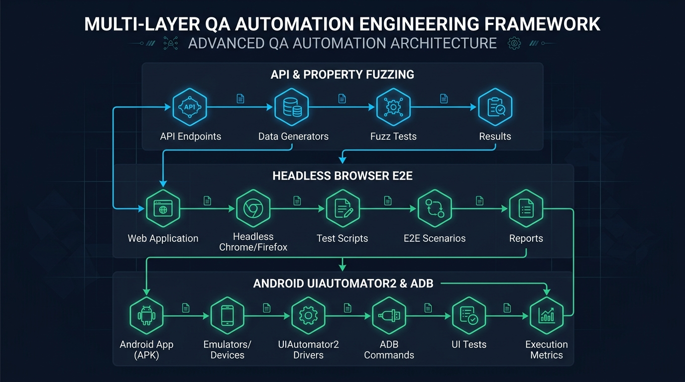
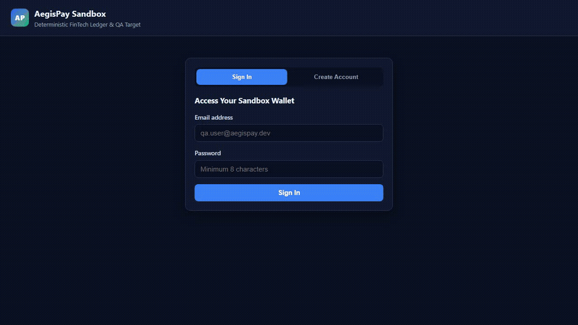
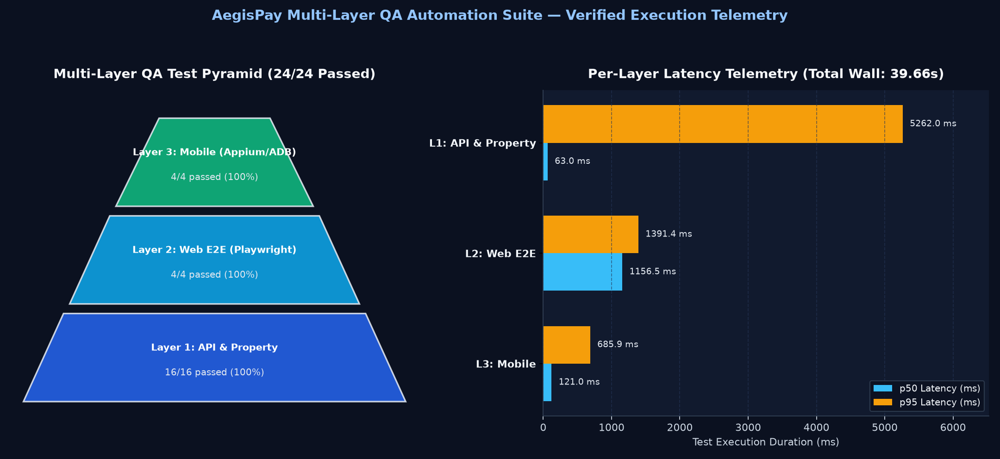
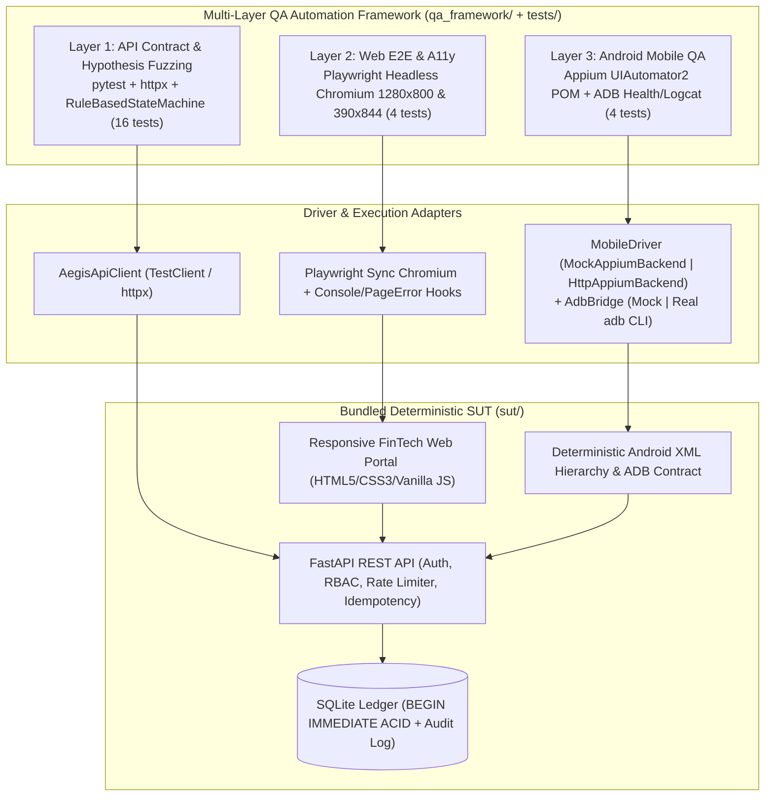
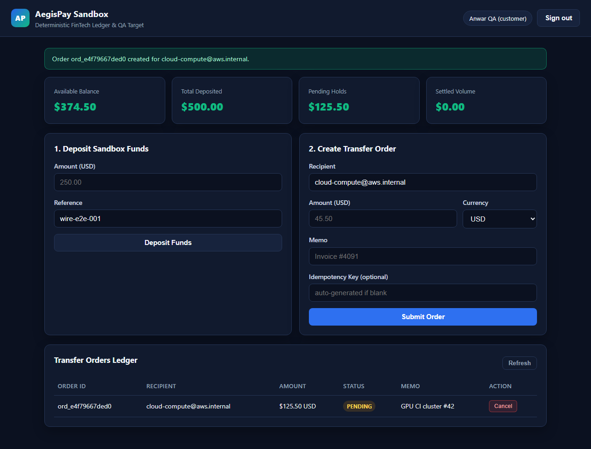
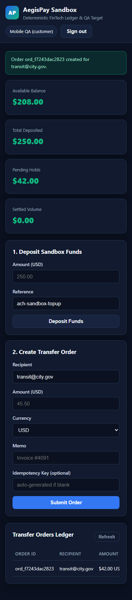

# AegisPay Multi-Layer QA Automation Suite



A **Staff-Engineer / PhD-grade Multi-Layer QA Automation Framework** targeting a deterministic FinTech Ledger, Auth, and Order Sandbox (**AegisPay**). Designed for **zero-flakiness CI/CD execution**, the framework spans three synchronized verification tiers—**API Contract + Property-Based Stateful Fuzzing**, **Headless Browser E2E + Accessibility/Responsive Audits**, and **Android Mobile UIAutomator2 Page Object Model + ADB Health/Logcat Gating**—backed by a live FastAPI + SQLite System Under Test (`sut/`).

---

## Live Walkthrough & Visual Proof

| Walkthrough Preview (Web Portal + HTML Report) | Test Pyramid & Latency Telemetry |
| :---: | :---: |
|  |  |

- **Full Recorded Video**: [`docs/images/qa-walkthrough.mp4`](docs/images/qa-walkthrough.mp4) (`428.1 KB`) | [`docs/images/qa-walkthrough.webm`](docs/images/qa-walkthrough.webm) (`1.64 MB`)
- **Desktop E2E (`1280x800`)**: [`docs/images/playwright-e2e.png`](docs/images/playwright-e2e.png)
- **Mobile Responsive (`390x844`)**: [`docs/images/playwright-mobile-390x844.png`](docs/images/playwright-mobile-390x844.png)
- **Deep Technical Analysis**: [`docs/CASE_STUDY.md`](docs/CASE_STUDY.md) | **Verification Ledger**: [`docs/PROOF_OF_WORK.md`](docs/PROOF_OF_WORK.md)

---

## System & Verification Architecture



---

## Test Pyramid Economics & Observed Telemetry

From the verified run recorded in `reports/qa-summary.json` (`24/24 passed`, `100.0%`, wall time `39.662 s`):

| Pyramid Layer | Sub-Layers Covered | Count | Pass Rate | p50 Latency | p95 Latency | Total Layer Time |
| :--- | :--- | :---: | :---: | :---: | :---: | :---: |
| **Layer 1: API & Property** | API Contract / RBAC / Idempotency / Rate Limit (`12`) + Hypothesis Fuzz & Stateful (`4`) | **16** | **100.0%** | `63.03 ms` | `5261.98 ms` | `20806.80 ms` |
| **Layer 2: Web E2E** | Playwright Headless Chromium (`1280x800` & `390x844` + A11y + Console Hygiene) | **4** | **100.0%** | `1156.49 ms` | `1391.39 ms` | `4707.27 ms` |
| **Layer 3: Mobile QA** | ADB Device/Package/Memory/Logcat Smoke (`2`) + Appium UIAutomator2 POM (`2`) | **4** | **100.0%** | `121.00 ms` | `685.87 ms` | `1006.70 ms` |
| **Total Suite** | **All 3 Verification Tiers** | **24** | **100.0%** | — | — | **`39.662 s` wall** |

### Why This Pyramid Ratio Works
- **API Contract Tests (`p50 = 63.03 ms`)** execute ~18x faster than browser E2E tests (`1156.49 ms`), enabling exhaustive verification of JWT validation, RBAC matrices (`customer` / `analyst` / `admin`), idempotency replay/conflict (`409`), and sliding-window rate limits (`429`) without browser overhead.
- **Hypothesis Property & Stateful Amplification**: The 4 property-based tests expand into **40+40+30 randomized boundary/idempotency examples** plus **25 stateful runs x 18 transitions** via `LedgerStateMachine(RuleBasedStateMachine)`, checking conservation of money (`balance + pending + settled == total_deposited`) after every single transition.
- **E2E & Mobile Layers Stay Focused**: Layer 2 (`4` Playwright tests) and Layer 3 (`4` Appium/ADB tests) concentrate strictly on true end-to-end user journeys, DOM accessibility, viewport overflow, Android XML locator resolution, and logcat crash/ANR gating.

---

## Tools, Skills, QA Frameworks & Stack

| Category | Technologies & Standards Used | Purpose in This Repository |
| :--- | :--- | :--- |
| **Test Runner & Telemetry** | `pytest 9.2`, `pytest-json-report` | Unified multi-layer test orchestration, strict markers (`api`, `property`, `web`, `mobile`), structured JSON telemetry |
| **API & Contract Testing** | `httpx`, FastAPI `TestClient`, OpenAPI 3.1 | Schema verification, Bearer HS256 JWT validation, RBAC matrix, `Idempotency-Key` replay/conflict, deterministic `FakeClock` rate-limit verification |
| **Property-Based & Stateful Fuzzing** | `Hypothesis` (`@given`, `RuleBasedStateMachine`, `Bundle`, `@invariant`) | Unicode/SQLi/XSS boundary fuzzing & reference shadow-ledger equivalence checking |
| **Web E2E & Accessibility** | `Playwright` (Chromium headless), WCAG/ARIA DOM audits | Login/validation/checkout workflows, `console.error` & `pageerror` assertions, `<label for>` + landmark audits, `1280x800` & `390x844` layout overflow checks |
| **Mobile Automation & Diagnostics** | W3C WebDriver / Appium `UIAutomator2` POM, `ADB` (`get-state`, `pm`, `am start -W`, `dumpsys meminfo`, `logcat`) | Cross-screen Android Page Object Model (`accessibility id`, `id`, `xpath`), cold-start latency & PSS memory budgets, fatal exception/ANR logcat gating |
| **Target System Under Test (SUT)** | `FastAPI`, `Pydantic v2` (`extra="forbid"`), `SQLite` (`BEGIN IMMEDIATE` ACID), `PyJWT`, `PBKDF2-HMAC-SHA256`, HTML5/CSS3/Vanilla JS | Self-contained FinTech sandbox eliminating external network flakiness |
| **Static Quality & CI/CD** | `Ruff` (lint + format), `Mypy --strict`, `GitHub Actions`, `Matplotlib`, `NumPy`, `FFmpeg` | Automated static gates, standalone HTML/JSON/PNG reporting, `.webm`/`.mp4`/`.gif` visual walkthrough generation |

---

## Desktop & Mobile Visual Verification

| Desktop E2E Portal (`1280x800`) | Mobile Responsive Audit (`390x844`) |
| :---: | :---: |
|  |  |

---

## Real vs. Mocked Android Emulator Execution

Layer 3 is engineered around an explicit **Driver Backend & ADB Bridge Abstraction** (`qa_framework/mobile/driver.py` and `qa_framework/mobile/adb.py`):

| Mode (`QA_MOBILE_MODE`) | Appium Driver Backend | ADB Command Execution | Use Case |
| :--- | :--- | :--- | :--- |
| **`mock` (default)** | `MockAppiumBackend` -> `DeterministicMobileBridge` (`sut/mobile_bridge.py`) | Deterministic `adb` contract (`sdk=34`, `am start -W`, `dumpsys meminfo`, `logcat` + fault injection) | Local dev & GitHub Actions CI without KVM/Android emulator overhead; mutates live FastAPI + SQLite state and parses real Android `<hierarchy>` XML via `ElementTree` |
| **`appium`** | `HttpAppiumBackend` -> live Appium 2.x W3C WebDriver REST server (`APPIUM_SERVER_URL`) | Real `subprocess.run(["adb", "-s", serial, ...])` against attached emulator/device | Physical device farm or local Android Studio AVD verification |

---

## Quickstart & Commands

### 1. Environment Setup
```bash
python -m venv .venv
# Windows: .venv\Scripts\activate  |  Linux/macOS: source .venv/bin/activate
pip install -e ".[dev]"
python -m playwright install chromium
```

### 2. Static Gates (Lint, Format, Strict Typecheck)
```bash
ruff check .
ruff format --check .
mypy sut qa_framework tests scripts
```

### 3. Run Individual QA Layers or Full Suite + Visual Reports
```bash
# Run all 3 layers + generate JSON, HTML report, and Pyramid PNG chart
python scripts/generate_reports.py

# Or target a single layer via pytest markers
pytest -m api
pytest -m property
pytest -m web
pytest -m mobile

# Capture Playwright screen-recorded walkthrough (.webm, .mp4, .gif)
python scripts/capture_walkthrough.py
```

### 4. Run the Target SUT Interactively
```bash
uvicorn sut.app:app --reload --port 8000
# Open http://127.0.0.1:8000 for the Web Portal or http://127.0.0.1:8000/docs for Swagger UI
```

---

## Repository Structure

```text
qa-automation-suite/
├── .github/workflows/ci.yml        # Ruff + Mypy strict + 3-layer pytest + artifact upload
├── sut/                            # Bundled deterministic FinTech + Android contract SUT
│   ├── app.py                      # FastAPI endpoints, JWT auth, RBAC, idempotency, rate limit
│   ├── database.py                 # ACID SQLite ledger (users, orders, ledger_entries, audit_logs)
│   ├── models.py                   # Strict Pydantic v2 schemas (extra="forbid")
│   ├── rate_limit.py               # Injectable-clock sliding-window rate limiter
│   ├── security.py                 # PBKDF2-HMAC-SHA256, HS256 JWT, canonical SHA-256 hashing
│   ├── mobile_bridge.py            # Deterministic Android UIAutomator2 XML & ADB bridge
│   └── static/                     # Accessible responsive HTML/CSS/JS portal
├── qa_framework/                   # Reusable QA automation core
│   ├── api_client.py               # Typed httpx client wrapper
│   ├── config.py                   # Environment-driven QAExecutionConfig
│   ├── mobile/                     # AdbBridge, W3C MobileDriver, and Android Page Objects
│   └── reporting/                  # Pytest JSON collector, Matplotlib pyramid chart, HTML report
├── tests/
│   ├── conftest.py                 # Isolated SUT, live uvicorn E2E server, mobile driver fixtures
│   ├── api/                        # Layer 1: Auth/RBAC, orders/idempotency, rate limit, Hypothesis
│   ├── web/                        # Layer 2: Playwright desktop & 390x844 E2E + a11y/console checks
│   └── mobile/                     # Layer 3: ADB smoke/logcat gate & Appium POM E2E
├── scripts/
│   ├── generate_reports.py         # Runs full suite -> qa-summary.json, qa-report.html, PNG chart
│   └── capture_walkthrough.py      # Records Playwright .webm/.mp4/.gif walkthrough
└── docs/
    ├── CASE_STUDY.md               # Architectural & mathematical verification deep dive
    ├── PROOF_OF_WORK.md            # Verbatim verification logs & evidence ledger
    └── images/                     # Committed screenshots, chart, hero banner, walkthrough media
```
