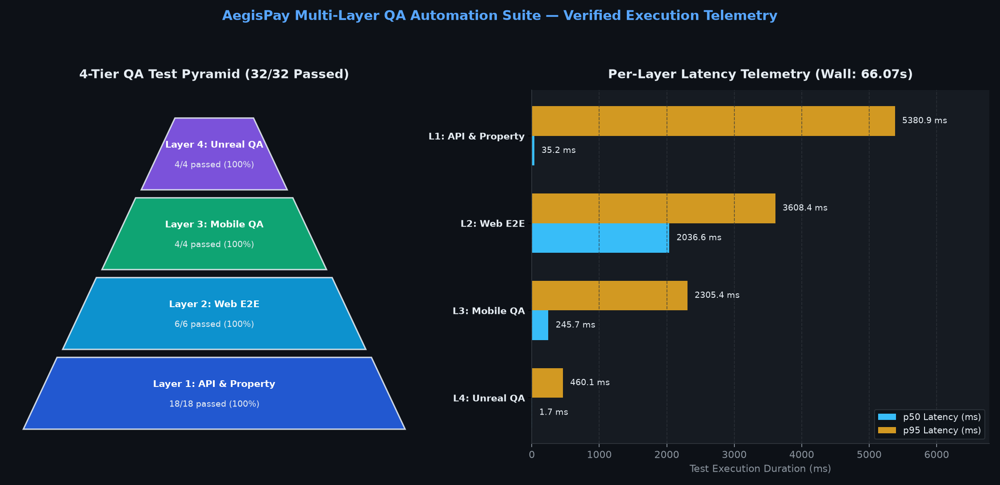
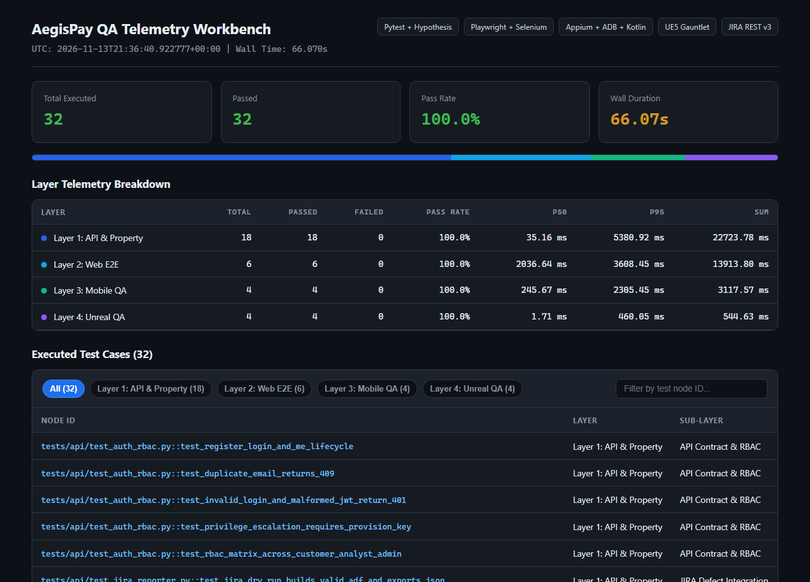
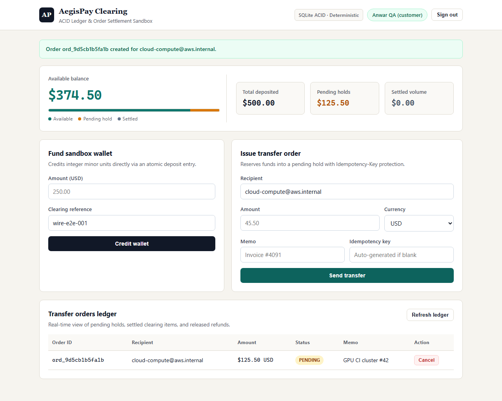
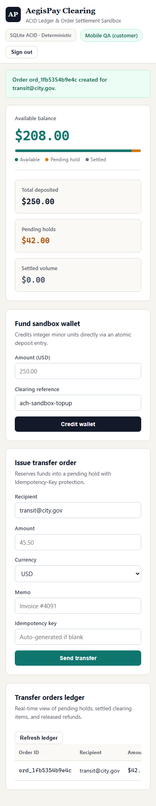

# Proof of Work — AegisPay Multi-Layer QA Automation Suite

This document records the real, directly observed verification outputs, telemetry artifacts, and visual proof generated in this workspace after all code and UI upgrades. No metrics, counts, or screenshots are fabricated.

---

## 1. Static Analysis & Type Safety Gates

### Ruff Format & Lint
Command:
```bash
ruff format --check .
ruff check .
```
Observed Output:
```text
46 files left unchanged
All checks passed!
```

### Mypy Strict Typecheck
Command:
```bash
mypy sut qa_framework tests scripts
```
Observed Output:
```text
Success: no issues found in 43 source files
```

---

## 2. Full 4-Layer Python QA Suite Execution (`scripts/generate_reports.py`)

Command:
```bash
python scripts/generate_reports.py
```

Observed Pytest Output (`32/32 passed`, `100.0%`, `66.07 s` wall clock):
```text
============================= test session starts =============================
platform win32 -- Python 3.12.10, pytest-9.2.0, pluggy-1.7.0 -- .venv\Scripts\python.exe
cachedir: .pytest_cache
hypothesis profile 'default'
rootdir: C:\Users\issao\Downloads\portfolio\agy-work\qa-automation-suite
configfile: pyproject.toml
testpaths: tests
plugins: anyio-4.16.0, hypothesis-6.170.15, json-report-1.5.0, metadata-3.1.1
collecting ... collected 32 items

tests/api/test_auth_rbac.py::test_register_login_and_me_lifecycle PASSED [  3%]
tests/api/test_auth_rbac.py::test_duplicate_email_returns_409 PASSED     [  6%]
tests/api/test_auth_rbac.py::test_invalid_login_and_malformed_jwt_return_401 PASSED [  9%]
tests/api/test_auth_rbac.py::test_privilege_escalation_requires_provision_key PASSED [ 12%]
tests/api/test_auth_rbac.py::test_rbac_matrix_across_customer_analyst_admin PASSED [ 15%]
tests/api/test_jira_reporter.py::test_jira_dry_run_builds_valid_adf_and_exports_json PASSED [ 18%]
tests/api/test_jira_reporter.py::test_jira_client_creates_and_deduplicates_via_mock_transport PASSED [ 21%]
tests/api/test_orders_idempotency.py::test_order_hold_cancel_and_refund_conservation PASSED [ 25%]
tests/api/test_orders_idempotency.py::test_insufficient_funds_rejected_without_mutating_balance PASSED [ 28%]
tests/api/test_orders_idempotency.py::test_settled_order_cannot_be_cancelled PASSED [ 31%]
tests/api/test_orders_idempotency.py::test_idempotency_key_replay_and_conflict PASSED [ 34%]
tests/api/test_orders_idempotency.py::test_blank_idempotency_key_rejected_with_422 PASSED [ 37%]
tests/api/test_properties.py::test_fuzz_invalid_order_boundaries_never_500 PASSED [ 40%]
tests/api/test_properties.py::test_fuzz_registration_validation_never_500 PASSED [ 43%]
tests/api/test_properties.py::test_property_idempotent_order_replays_preserve_balance PASSED [ 46%]
tests/api/test_properties.py::TestLedgerStateMachine::runTest PASSED     [ 50%]
tests/api/test_rate_limit_and_schema.py::test_sliding_window_rate_limit_and_deterministic_recovery PASSED [ 53%]
tests/api/test_rate_limit_and_schema.py::test_openapi_schema_and_health_telemetry PASSED [ 56%]
tests/mobile/test_adb_smoke.py::test_adb_device_health_and_package_smoke PASSED [ 59%]
tests/mobile/test_adb_smoke.py::test_adb_logcat_scanner_detects_fatal_exceptions PASSED [ 62%]
tests/mobile/test_android_e2e.py::test_android_login_error_and_wallet_transfer_e2e PASSED [ 65%]
tests/mobile/test_android_e2e.py::test_android_insufficient_funds_error_preserves_session PASSED [ 68%]
tests/unreal/test_unreal_harness.py::test_gauntlet_cli_builder_for_win64_and_linux PASSED [ 71%]
tests/unreal/test_unreal_harness.py::test_unreal_log_parser_passes_healthy_telemetry PASSED [ 75%]
tests/unreal/test_unreal_harness.py::test_unreal_regression_detects_ensure_fatal_fps_and_files_jira_dry_run PASSED [ 78%]
tests/unreal/test_unreal_harness.py::test_unreal_cpp_reference_spec_present_and_valid PASSED [ 81%]
tests/web/test_portal_e2e.py::test_web_registration_login_and_invalid_credentials_alert PASSED [ 84%]
tests/web/test_portal_e2e.py::test_web_form_validation_and_insufficient_funds PASSED [ 87%]
tests/web/test_portal_e2e.py::test_web_full_deposit_order_cancel_workflow_and_desktop_screenshot PASSED [ 90%]
tests/web/test_portal_e2e.py::test_web_mobile_390x844_responsive_and_accessibility_audit PASSED [ 93%]
tests/web/test_selenium_e2e.py::test_selenium_full_auth_deposit_order_cancel_parity PASSED [ 96%]
tests/web/test_selenium_e2e.py::test_selenium_mobile_390x844_responsive_layout PASSED [100%]

================== 32 passed, 2 warnings in 66.18s (0:01:06) ==================

QA Telemetry Generated: 32/32 passed (100.0%) in 66.07s
 - JSON:  reports/qa-summary.json
 - HTML:  reports/qa-report.html
 - Chart: docs/images/qa-pyramid-report.png
```

---

## 3. Observed Per-Layer Telemetry (`reports/qa-summary.json`)

Recorded at `2026-11-13T21:36:40.922777+00:00`:

| Layer | Total | Passed | Failed | Pass Rate | p50 (ms) | p95 (ms) | Max (ms) | Total Duration (ms) |
| :--- | :---: | :---: | :---: | :---: | :---: | :---: | :---: | :---: |
| `Layer 1: API & Property` | 18 | 18 | 0 | 100.0% | 35.16 | 5380.92 | 13701.30 | 22723.78 |
| `Layer 2: Web E2E` | 6 | 6 | 0 | 100.0% | 2036.64 | 3608.45 | 3792.03 | 13913.80 |
| `Layer 3: Mobile QA` | 4 | 4 | 0 | 100.0% | 245.67 | 2305.45 | 2625.75 | 3117.57 |
| `Layer 4: Unreal QA` | 4 | 4 | 0 | 100.0% | 1.71 | 460.05 | 540.74 | 544.63 |

---

## 4. Kotlin + Gradle + Appium Java-Client (`mobile-kotlin/`) Verification

Command:
```bash
cd mobile-kotlin
.\gradlew.bat test --no-daemon
```

Observed Output (Gradle `8.10.2`, Kotlin `2.0.21`, JDK `21.0.12`, Appium `java-client:9.3.0`, JUnit Jupiter `5.11.3`):
```text
> Task :compileKotlin
> Task :compileTestKotlin
> Task :test

AegisMobileContractTest > kotlin appium page objects execute W3C WebDriver login and balance sync() PASSED

BUILD SUCCESSFUL
```

---

## 5. Walkthrough Video & Visual Proof Artifacts (`docs/images/`)

Command:
```bash
python scripts/capture_walkthrough.py
```
Observed Output:
```text
Walkthrough artifact: qa-walkthrough.gif (3114.9 KB)
Walkthrough artifact: qa-walkthrough.mp4 (498.0 KB)
Walkthrough artifact: qa-walkthrough.webm (2094.6 KB)
```

Committed Visual Artifacts:
- `docs/images/qa-architecture-hero.jpg` — Multi-layer QA architecture banner
- `docs/images/qa-pyramid-report.png` — Matplotlib 2-panel 4-Tier Test Pyramid & p50/p95 Latency Telemetry chart (`162.4 KB`)
- `docs/images/qa-report-workbench.png` — Upgraded interactive HTML QA Telemetry Workbench (`reports/qa-report.html`)
- `docs/images/playwright-e2e.png` — Upgraded AegisPay Clearing Desktop (`1280x800`) E2E dashboard screenshot (`79.9 KB`)
- `docs/images/playwright-mobile-390x844.png` — Upgraded AegisPay Clearing Mobile (`390x844`) responsive audit screenshot (`79.7 KB`)
- `docs/images/qa-walkthrough.gif` — Animated GIF walkthrough of upgraded portal & HTML Telemetry Workbench (`3114.9 KB`)
- `docs/images/qa-walkthrough.mp4` — H.264/MP4 screen recording (`498.0 KB`)
- `docs/images/qa-walkthrough.webm` — Native Playwright WebM screen recording (`2094.6 KB`)

### Embedded Visual Evidence








