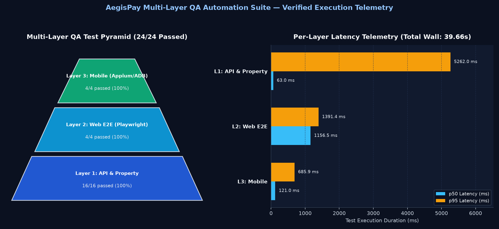
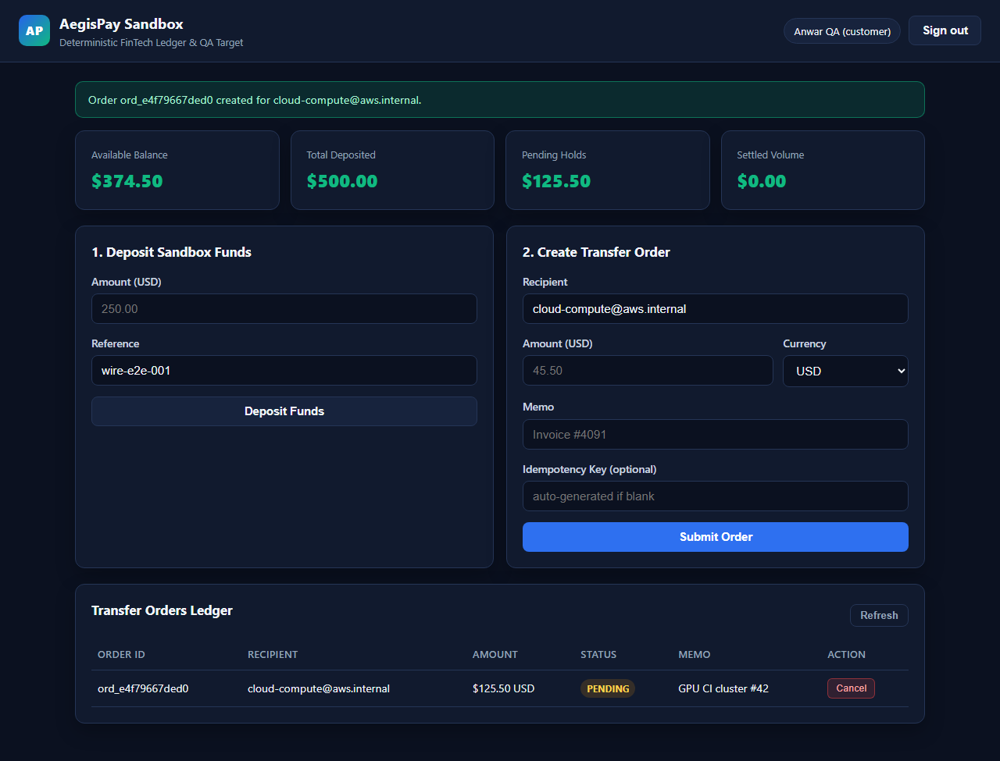
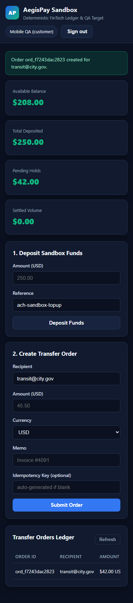

# Proof of Work — AegisPay Multi-Layer QA Automation Suite

This document records the real, directly observed verification outputs, telemetry artifacts, and visual proof generated in this workspace. No metrics or outputs are fabricated.

---

## 1. Static Analysis & Type Safety Gates

### Ruff Format & Lint
Command:
```bash
ruff format --check .
ruff check .
```
Observed Output:
```text
38 files already formatted
All checks passed!
```

### Mypy Strict Typecheck
Command:
```bash
mypy sut qa_framework tests scripts
```
Observed Output:
```text
Success: no issues found in 35 source files
```

---

## 2. Full 3-Layer QA Suite Execution (`scripts/generate_reports.py`)

Command:
```bash
python scripts/generate_reports.py
```

Observed Pytest Output (`24/24 passed`, `100.0%`, `39.66s`):
```text
============================= test session starts =============================
platform win32 -- Python 3.12.10, pytest-9.2.0, pluggy-1.7.0
rootdir: C:\Users\issao\Downloads\portfolio\agy-work\qa-automation-suite
configfile: pyproject.toml
testpaths: tests
plugins: anyio-4.16.0, hypothesis-6.170.15, json-report-1.5.0, metadata-3.1.1
collecting ... collected 24 items

tests/api/test_auth_rbac.py::test_register_login_and_me_lifecycle PASSED [  4%]
tests/api/test_auth_rbac.py::test_duplicate_email_returns_409 PASSED     [  8%]
tests/api/test_auth_rbac.py::test_invalid_login_and_malformed_jwt_return_401 PASSED [ 12%]
tests/api/test_auth_rbac.py::test_privilege_escalation_requires_provision_key PASSED [ 16%]
tests/api/test_auth_rbac.py::test_rbac_matrix_across_customer_analyst_admin PASSED [ 20%]
tests/api/test_orders_idempotency.py::test_order_hold_cancel_and_refund_conservation PASSED [ 25%]
tests/api/test_orders_idempotency.py::test_insufficient_funds_rejected_without_mutating_balance PASSED [ 29%]
tests/api/test_orders_idempotency.py::test_settled_order_cannot_be_cancelled PASSED [ 33%]
tests/api/test_orders_idempotency.py::test_idempotency_key_replay_and_conflict PASSED [ 37%]
tests/api/test_orders_idempotency.py::test_blank_idempotency_key_rejected_with_422 PASSED [ 41%]
tests/api/test_properties.py::test_fuzz_invalid_order_boundaries_never_500 PASSED [ 45%]
tests/api/test_properties.py::test_fuzz_registration_validation_never_500 PASSED [ 50%]
tests/api/test_properties.py::test_property_idempotent_order_replays_preserve_balance PASSED [ 54%]
tests/api/test_properties.py::TestLedgerStateMachine::runTest PASSED     [ 58%]
tests/api/test_rate_limit_and_schema.py::test_sliding_window_rate_limit_and_deterministic_recovery PASSED [ 62%]
tests/api/test_rate_limit_and_schema.py::test_openapi_schema_and_health_telemetry PASSED [ 66%]
tests/mobile/test_adb_smoke.py::test_adb_device_health_and_package_smoke PASSED [ 70%]
tests/mobile/test_adb_smoke.py::test_adb_logcat_scanner_detects_fatal_exceptions PASSED [ 75%]
tests/mobile/test_android_e2e.py::test_android_login_error_and_wallet_transfer_e2e PASSED [ 79%]
tests/mobile/test_android_e2e.py::test_android_insufficient_funds_error_preserves_session PASSED [ 83%]
tests/web/test_portal_e2e.py::test_web_registration_login_and_invalid_credentials_alert PASSED [ 87%]
tests/web/test_portal_e2e.py::test_web_form_validation_and_insufficient_funds PASSED [ 91%]
tests/web/test_portal_e2e.py::test_web_full_deposit_order_cancel_workflow_and_desktop_screenshot PASSED [ 95%]
tests/web/test_portal_e2e.py::test_web_mobile_390x844_responsive_and_accessibility_audit PASSED [100%]

======================= 24 passed, 1 warning in 39.66s ========================

QA Telemetry Generated: 24/24 passed (100.0%) in 39.66s
 - JSON:  reports/qa-summary.json
 - HTML:  reports/qa-report.html
 - Chart: docs/images/qa-pyramid-report.png
```

---

## 3. Observed Per-Layer Telemetry (`reports/qa-summary.json`)

Recorded at `2026-11-13T21:18:25.924099+00:00`:

| Layer | Total | Passed | Failed | Pass Rate | p50 (ms) | p95 (ms) | Max (ms) | Total Duration (ms) |
| :--- | :---: | :---: | :---: | :---: | :---: | :---: | :---: | :---: |
| `Layer 1: API & Property` | 16 | 16 | 0 | 100.0% | 63.03 | 5261.98 | 11460.14 | 20806.80 |
| `Layer 2: Web E2E (Playwright)` | 4 | 4 | 0 | 100.0% | 1156.49 | 1391.39 | 1424.41 | 4707.27 |
| `Layer 3: Mobile (Appium/ADB)` | 4 | 4 | 0 | 100.0% | 121.00 | 685.87 | 764.33 | 1006.70 |

---

## 4. Walkthrough Video & Visual Proof Artifacts (`docs/images/`)

Command:
```bash
python scripts/capture_walkthrough.py
```
Observed Output:
```text
Walkthrough artifact: qa-walkthrough.gif (4078.2 KB)
Walkthrough artifact: qa-walkthrough.mp4 (428.1 KB)
Walkthrough artifact: qa-walkthrough.webm (1681.3 KB)
```

Committed Visual Artifacts:
- `docs/images/qa-architecture-hero.jpg` — Multi-layer QA architecture banner
- `docs/images/qa-pyramid-report.png` — Matplotlib 2-panel Test Pyramid & p50/p95 Latency Telemetry chart
- `docs/images/playwright-e2e.png` — Live Playwright Desktop (`1280x800`) E2E dashboard screenshot
- `docs/images/playwright-mobile-390x844.png` — Live Playwright Mobile (`390x844`) responsive audit screenshot
- `docs/images/qa-walkthrough.gif` — Lightweight animated GIF walkthrough of portal & HTML report (`~4.0 MB`)
- `docs/images/qa-walkthrough.mp4` — H.264/MP4 screen recording (`428.1 KB`)
- `docs/images/qa-walkthrough.webm` — Native Playwright WebM screen recording (`1.64 MB`)

### Embedded Visual Evidence






